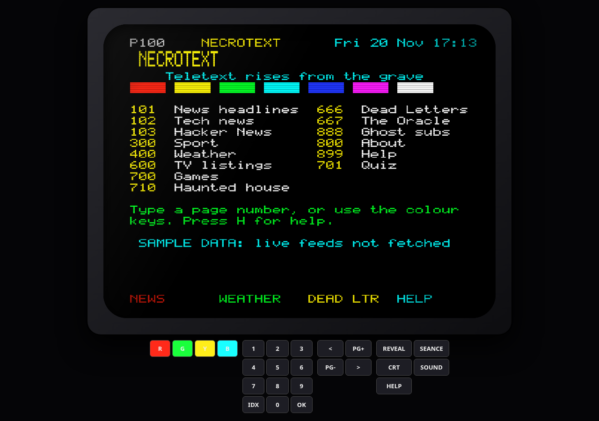
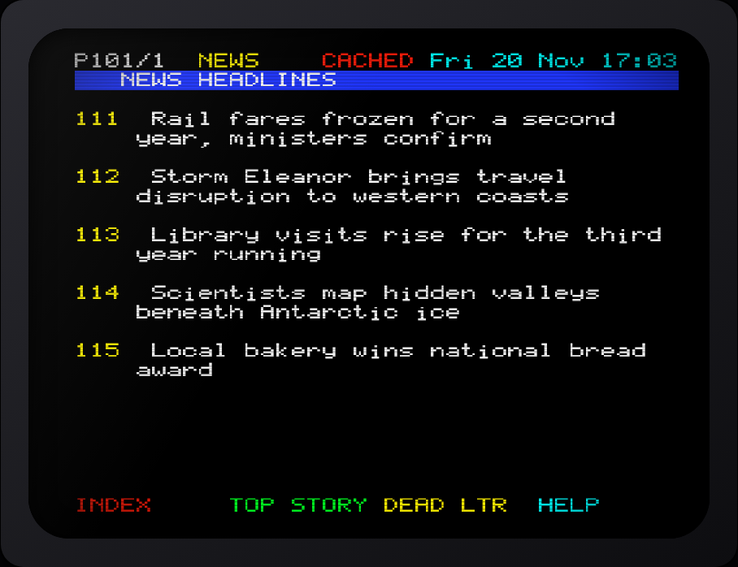
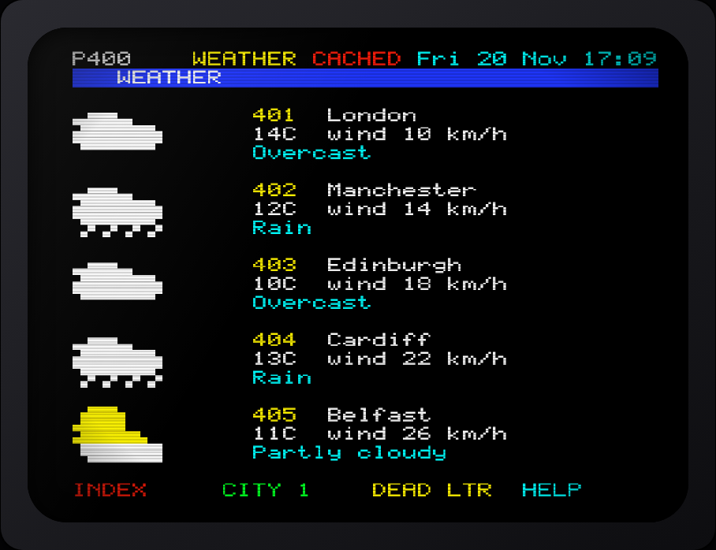
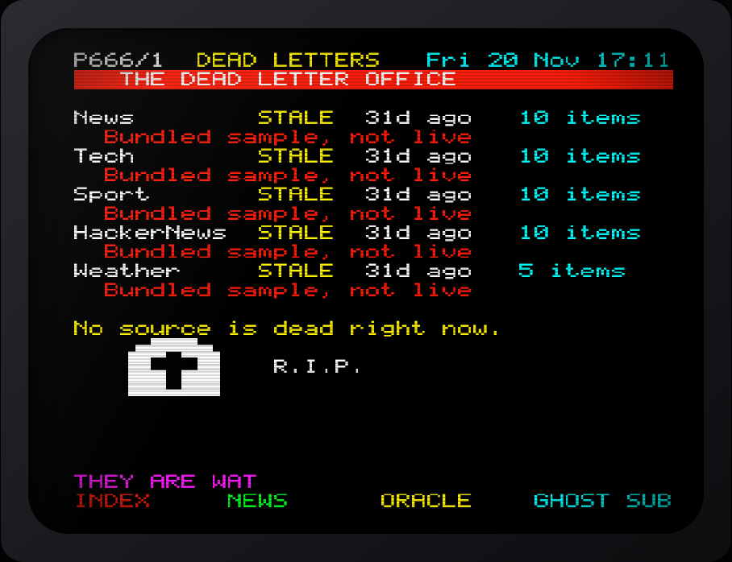
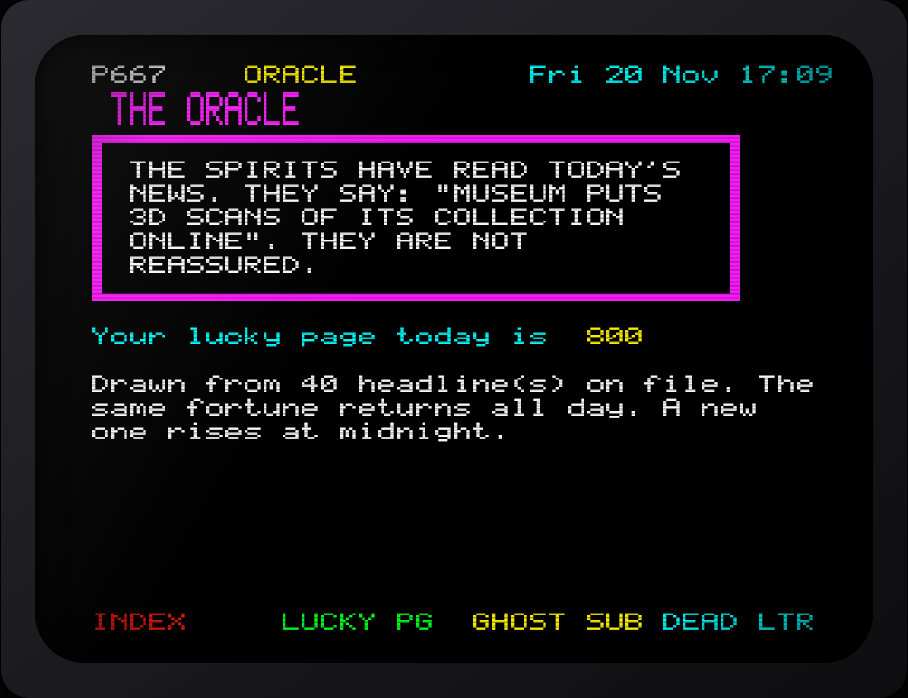
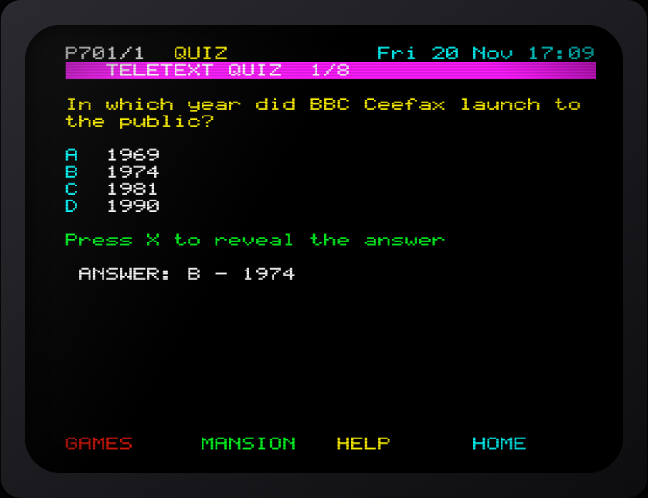
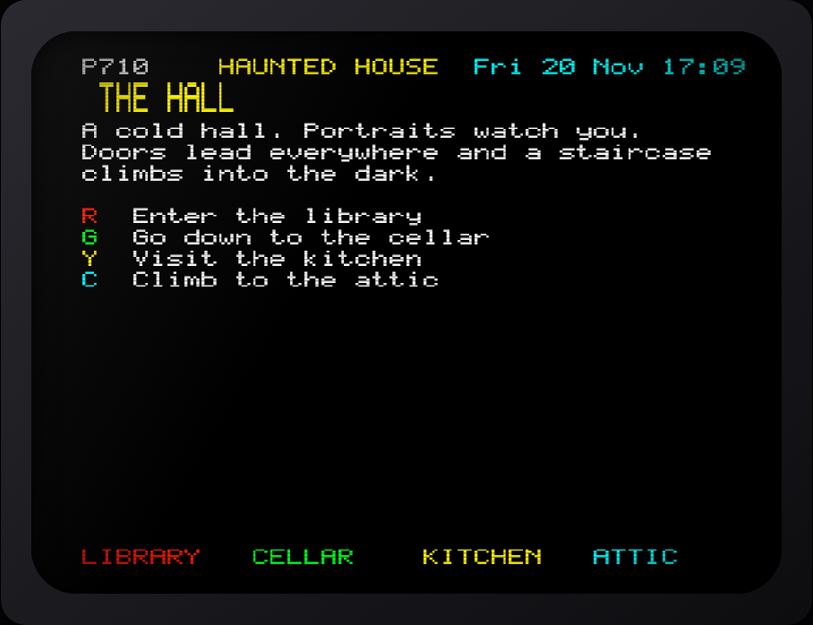

# NecroText

**Teletext rises from the grave.** NecroText revives Ceefax and Oracle as a static web app: 40 by 24 pages, mosaic graphics, colour keys, three digit page numbers, live headlines and weather, and a haunted layer that is genuinely useful. It has zero dependencies and runs on GitHub Pages.

**Live:** https://aqeelabpro.github.io/necrotext/
**Repo:** https://github.com/aqeelabpro/necrotext
**Kiroween 2026, category: Resurrection.** Teletext died with analogue TV in 2012.



| News | Weather | Dead Letter Office |
|---|---|---|
|  |  |  |
| **The Oracle** | **Quiz (X reveals)** | **Haunted house** |
|  |  |  |

Screenshots are real Chromium renders of the built site. Before and after the display fixes (clipped edges, fallback font): [before](docs/screens/before-100.png), [after](docs/screens/page-100.png).

## Features

- A real serial attribute model: control codes take a cell, colours apply to the next cell, mosaic sixels, double height, flash, conceal, hold. It is not a CSS imitation.
- A hand-drawn 5 by 9 pixel font (`src/teletext/font.js`) so every browser shows identical glyphs, and an overscan safe area so nothing clips on a TV bezel.
- Pages: 100 index, 101 news, 102 tech, 103 Hacker News, 300 sport, 400 weather, 600 TV, 700 games (701 quiz, 710 haunted house), 800 about, 899 help.
- TV feel: type digits and `P4--` appears in the header, the page number searches, then the page loads. Colour keys follow Fastext links.
- CRT look with scanlines, vignette, glow and flicker. Respects `prefers-reduced-motion`.
- URL hash routing, for example `#/101/2`. On-screen remote control for phones.
- Bundled sample data so it works offline. Sample data is labelled on page 100, and stale data shows CACHED in red.

### The haunted layer

| Page | What it does |
|---|---|
| 666 The Dead Letter Office | Real diagnostics: each feed is ALIVE, STALE or DEAD, with age, item count, last error and stories missing a summary or link. |
| 667 The Oracle | A daily fortune quoting today's headlines. |
| 888 Ghost Subtitles | Whispers derived from the headlines. |
| 013 | Unlucky. Press X on it. |
| Ghosts | Now and then a message spells itself on row 22 using words from the page. |
| Seance (S) | Red tint, faster flicker, deliberate glyph corruption ([screenshot](docs/screens/seance.png)). |

### Keys

| Key | Action |
|---|---|
| 0-9 | Type a page number |
| R G Y B or F1-F4 | Red, green, yellow, cyan keys |
| Up / Down, + / - | Next / previous page |
| Left / Right | Previous / next subpage |
| 0 then Enter, Esc | Index |
| X | Reveal hidden text |
| S | Seance mode |
| C | CRT effect on or off |
| M | Sound on or off |
| H | Help overlay ([screenshot](docs/screens/help.png)) |

## Run it

Node 20 or newer. No `npm install`, there are no dependencies.

```bash
npm start                       # builds dist/ then serves http://localhost:8080
PORT=8081 npm start             # another port
```

## Test it

```bash
npm run lint         # syntax check, plus the "no em dash" rule across the repo
npm test             # unit, property and MCP tests
npm run check-grid   # render every page and check 40x24 and allowed codes
npm run build        # copy public/, src/, data/ into dist/
```

Property tests use a small seeded `forAll` in `tests/helpers/prop.js`. Replay a failure with `PROP_SEED=<seed> npm test`.

## How the live data works

- `npm run fetch-data` pulls BBC News, Technology and Sport RSS, Hacker News and Open-Meteo forecasts into `data/*.json`, with retries and validation. A failing source keeps its old snapshot and is recorded as dead on page 666.
- `.github/workflows/pages.yml` runs on push to `main`, every 30 minutes, and on demand. It tests on the bundled sample data (blocking), seeds `data/` from the last deployed site with `npm run seed-data`, fetches live data, runs informational tests on it, then deploys. Deploys are never cancelled mid-run, and a step summary lists the result.
- The `data/` files committed to the repo are hand-authored sample data (`fallback: true`). They are not real news. If the live fetch fails entirely, page 100 says SAMPLE DATA and page 666 says why.

## Deploy to GitHub Pages

Settings > Pages > Source: **GitHub Actions**. Push to `main`.

## Built with Kiro

Specs, steering, hooks, custom agents, an MCP server and a power are in the repo. [docs/HOW_KIRO_WAS_USED.md](docs/HOW_KIRO_WAS_USED.md) says what each one did and which are not yet confirmed inside the Kiro IDE.

- **MCP server:** `npm run mcp` starts `scripts/mcp-server.js`, a zero dependency stdio server. Tools: `list_pages`, `render_page`, `check_page`, `data_status`.
- **Custom agents:** `.kiro/agents/page-designer.md` (designs and previews pages) and `.kiro/agents/broadcast-reviewer.md` (read-only diff reviewer).
- **Power:** `powers/necrotext-teletext/` bundles the MCP config and two skills (`new-teletext-page`, `teletext-mosaics`).
- **Hooks:** five, in `.kiro/hooks/`.

## Project layout

```
src/teletext/   grid, control codes, mosaics, font, text, layout, renderer, shared page checks
src/pages/      page generators and the registry
src/ghost.js    haunted layer (pure, seeded)
src/ui/         key state machine and canvas drawing
public/         index.html, style.css, app.js, crt.js
scripts/        build, serve, fetch-data, seed-from-live, mcp-server, lint, check-grid
.kiro/          specs, steering, hooks, agents
powers/         the necrotext-teletext Kiro power
docs/           Kiro write-up, Devpost text, screenshots
```

## Licence

MIT, see [LICENSE](LICENSE).
