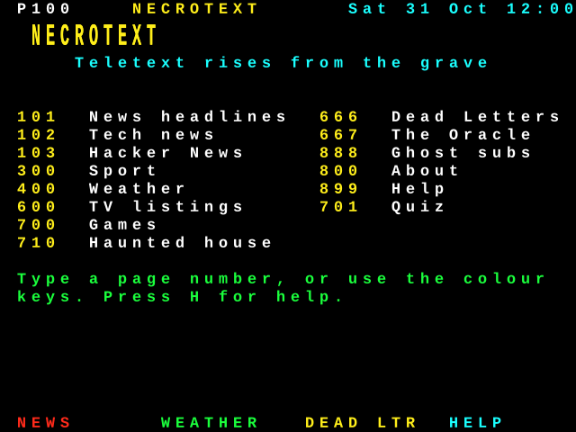
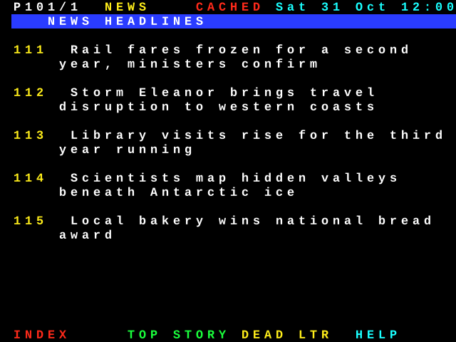
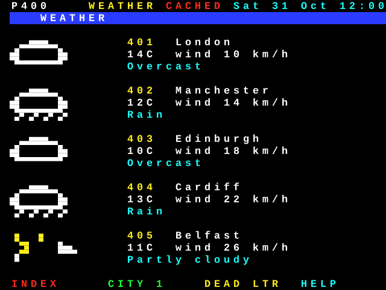
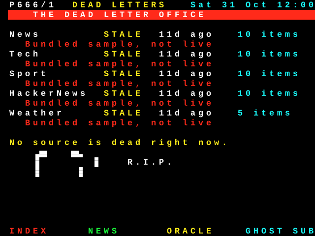

# NecroText

**Teletext rises from the grave.** A revival of Ceefax and Oracle as a web app: 40 by 24 pages, mosaic graphics, colour keys, three digit page numbers, live headlines and weather, and a haunted layer that is actually useful.

Built for **Kiroween 2026**, category **Resurrection**. Teletext died with analogue TV in 2012. NecroText brings it back.



| | | |
|---|---|---|
|  |  |  |

(Screenshots are generated without a browser by `npm run snapshot`.)

## Features

- Real serial attribute model: control codes take a cell, colours apply to the next cell, mosaic sixels, double height, flash, conceal, hold. Not a CSS imitation.
- Pages: 100 index, 101 news, 102 tech, 103 Hacker News, 300 sport, 400 weather, 600 TV, 700 games (quiz, haunted house), 800 about, 899 help.
- TV feel: type digits and watch `P4--` appear in the header, then the page number "searches" before the page loads. Colour keys follow Fastext links.
- CRT look: scanlines, vignette, glow, flicker. Toggle with C. Respects `prefers-reduced-motion`.
- URL hash routing, for example `#/101/2`.
- On-screen remote control for phones.
- Works offline from bundled sample data, and says CACHED in red when data is old.

### The haunted layer

| Page | What it does |
|---|---|
| 666 The Dead Letter Office | Real diagnostics: each feed is ALIVE, STALE or DEAD, with age, item count, last error and stories missing a summary or link. |
| 667 The Oracle | A daily fortune built from today's headlines. |
| 888 Ghost Subtitles | Whispers derived from the headlines. |
| 013 | Unlucky. Press X on it. |
| Ghosts | A message occasionally spells itself on row 22, built from words on the page. |
| S: Seance | Red tint, faster flicker, text corruption. |

## Run it

Requirements: Node 20 or newer. No `npm install` needed, there are no dependencies.

```bash
npm start            # builds dist/ then serves http://localhost:8080
# or
npm run build && PORT=8081 npm run serve
```

## Keys

| Key | Action |
|---|---|
| 0-9 | Type a page number |
| R G Y B or F1-F4 | Red, green, yellow, cyan keys |
| Up / Down, + / - | Next / previous page |
| Left / Right | Previous / next subpage |
| 0 then Enter, Esc | Index |
| X | Reveal hidden text (quiz answers) |
| S | Seance mode |
| C | CRT effect on or off |
| M | Sound on or off |
| H | Help overlay |

## Tests

```bash
npm test             # unit and property tests
npm run lint         # syntax check plus "no em dashes" rule
npm run check-grid   # render every page, check 40x24 and allowed codes
```

Property tests use a small seeded generator in `tests/helpers/prop.js` (`fast-check` could not be installed in the build sandbox, and `forAll` maps directly onto it). They push random, hostile feed data (emoji, em dashes, huge words, `null`, `NaN`) through every page and subpage and assert: 40x24, allowed codes only, page number in row 0, double height rows followed by a blank row, valid fastext targets. Replay a failure with `PROP_SEED=<seed> npm test`.

## Data

`npm run fetch-data` pulls BBC News, Technology and Sport RSS, Hacker News top stories and Open-Meteo forecasts for five UK cities into `data/*.json` and writes `data/status.json` for page 666. A failing source keeps its old snapshot and is recorded as dead.

The `data/` files committed here are **hand-authored sample data** (marked `fallback: true`) so the app works offline. They are not real news. A live run replaces them.

## Deploy to GitHub Pages

1. Push to GitHub.
2. Settings > Pages > Source: **GitHub Actions**.
3. The `deploy-pages` workflow runs on push to `main`, every 30 minutes (fresh data), and on demand.

## Project layout

```
src/teletext/   grid, control codes, mosaics, text, layout, serial attribute renderer
src/pages/      page generators and the registry
src/ghost.js    haunted layer (pure, seeded)
src/ui/         key state machine and canvas drawing
public/         index.html, style.css, app.js, crt.js
scripts/        build, serve, fetch-data, lint, check-grid, snapshot
.kiro/          specs, steering and hooks (see docs/HOW_KIRO_WAS_USED.md)
docs/           Kiro write up, Devpost draft, generated screenshots
```

## Built with Kiro

Specs, steering and hooks live in [`.kiro/`](.kiro). Read [docs/HOW_KIRO_WAS_USED.md](docs/HOW_KIRO_WAS_USED.md).

## Licence

MIT, see [LICENSE](LICENSE).
